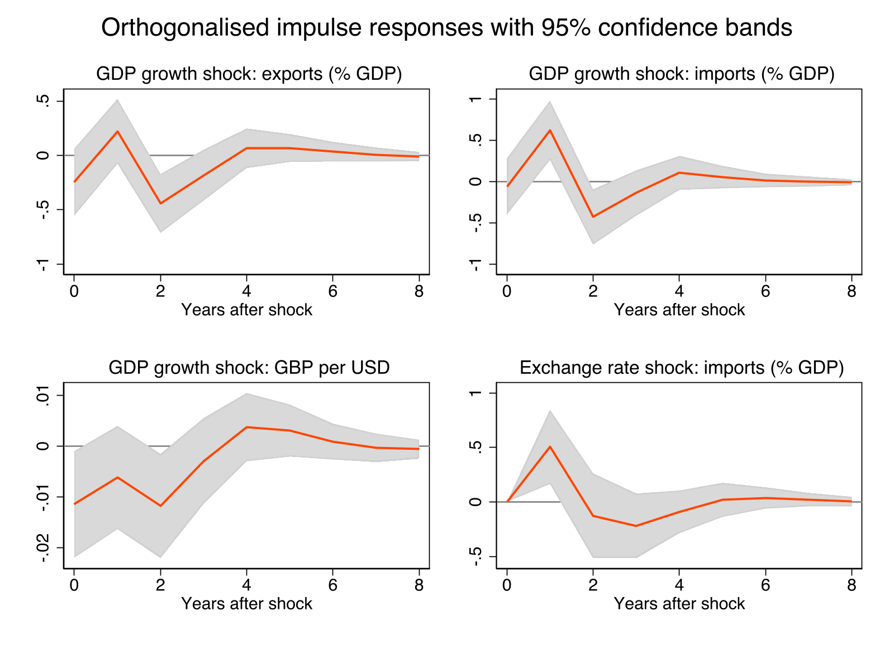
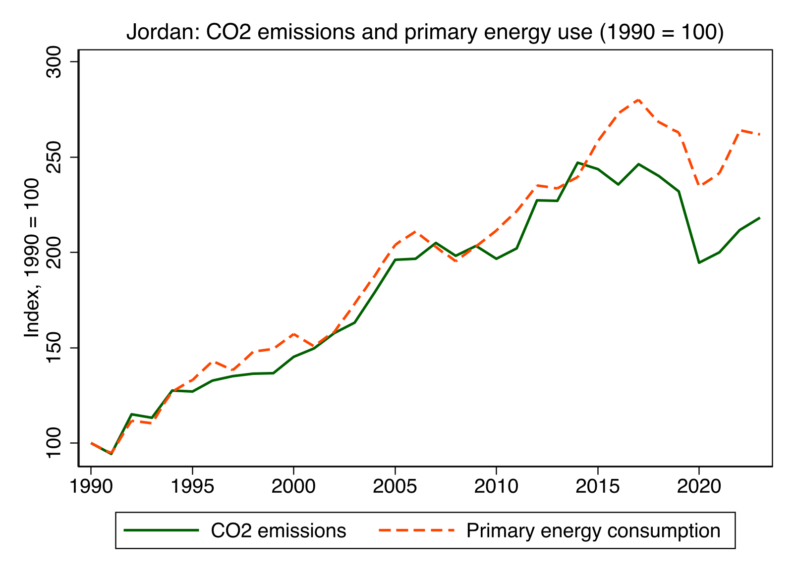

# Time-series econometrics in Stata

Two small projects on public data (World Bank, Our World in Data), each in one do-file.

## UK: GDP growth, trade and the exchange rate (1970-2025)

`code/01_uk_var.do` - real GDP growth, exports and imports (% of GDP), and GBP per USD.

- ADF tests: GDP growth is stationary; the other three are I(1).
- Johansen test: no cointegration at 5% - but it's close (trace 29.44 vs critical value 29.68).
- So I estimated a VAR in differences, 2 lags (AIC, FPE and LR agree), with dummies for 2020 and
  2021 so the pandemic doesn't dominate.
- Diagnostics are fine: no residual autocorrelation, residuals normal, VAR stable.

Granger causality results:

| Does this help predict... | ...this? | p-value |
|---|---|---|
| GDP growth | exports | < 0.001 |
| GDP growth | imports | < 0.001 |
| GDP growth | exchange rate | 0.003 |
| exchange rate | imports | 0.003 |
| exchange rate | exports | 0.036 |
| trade + exchange rate together | GDP growth | 0.141 (no) |

GDP growth predicts trade, but not the other way round. Imports react faster than exports: they
rise 0.62pp of GDP the year after a growth shock.

## Jordan: what drives CO2 emissions? (1991-2023)

`code/02_jordan_co2_ols.do` - OLS of CO2 growth on energy use, imports, exports and the budget
balance.

The first model failed the RESET test (p = 0.019). The biggest residual was 2020, when CO2 fell
17.5% but energy use only fell 11.4% (lockdown hit transport fuel hardest). Adding a 2020 dummy
fixed it, and the model then passes RESET, Breusch-Godfrey, Breusch-Pagan, ARCH and CUSUM.

| | Coefficient | Significant? |
|---|---|---|
| Energy consumption growth | 0.575 | yes (1%) |
| Imports growth | 0.196 | yes (5%) |
| Exports growth | -0.120 | no |
| Change in budget balance | 0.001 | no |
| 2020 dummy | -9.95 | yes (5%) |

R-squared 0.70, 33 observations. Energy use is the main driver. Emissions have grown more slowly
than energy since about 2014, which fits Jordan moving from oil to gas and solar.

This is a redo of an earlier EViews version (1991-2019). Some original series are no longer
published, so I used WTO merchandise trade instead of national-accounts trade and primary energy
instead of oil products, and used the change in the budget balance rather than its growth rate
(the balance is negative every year, so a growth rate doesn't make sense).

## Running it

`python code/00_build_data.py` downloads the data (the built CSVs are already in `data/`), then
run the two do-files from the project folder. Full output is in `output/`.
